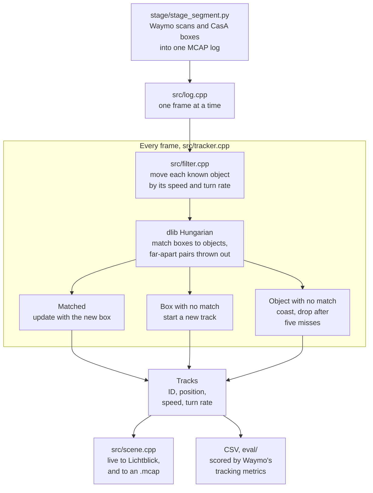

# Throughline

A C++ program that tracks cars, bikes and people in self-driving car LiDAR data, live.

A Waymo car records a laser scan of everything around it ten times a second, and a
detector draws a box around each object it finds in the scan. This program takes those
boxes as they arrive and follows each object from one scan to the next. It keeps the same
ID on a car even when the detector loses it for a few scans. It works out how fast each
object is going and which way it is turning, and it draws where it expects the object to
be three seconds from now. The whole scene streams to a viewer while it runs.

## Results

The input boxes come from CasA, a published LiDAR detector, using the detection files its
authors released for Waymo's validation set. Boxes scoring under 0.5 are dropped, and
pedestrian boxes under 0.7, where the detector's precision on these clips was lowest. The
detector is not part of this
project, so the scores below measure the tracker on real detector output, with the
detector's misses and false alarms included.

MOTA is the standard tracking score. 1.0 means no mistakes. Waymo's own scoring code,
run by `make official` on 2026-10-18, produced these numbers on three clips from their
validation set, at Waymo's LEVEL_2 difficulty:

| scene                       | cars | people |
|-----------------------------|------|--------|
| fast road, 63 km/h          | 0.30 | 0.22   |
| crawling through a junction | 0.54 | 0.57   |
| slow turn, 21 km/h          | 0.72 | 0.34   |

Most lost points on the fast road are misses: the detector does not see distant cars that
the labels contain, and the tracker waits two scans before it reports a new object.

From a frame being read to its scene being published takes 2 to 4 milliseconds at the
median and under 8 at the 99th percentile, measured by `make live` on the fast-road clip
with no viewer attached, on 2026-10-18. The tracking step itself is under 0.1 ms. The car
gives it 100.

## Architecture



Every frame, three steps.

1. Move each known object forward using its last speed and turn rate, and get a bit less sure
   where it is.
2. Match the new boxes to the known objects. Pairs that are too far apart are thrown out.
   The rest are matched so the total distance is as small as possible.
3. Update matched objects with their new box. Start a new track for any box that didn't match.
   Let unmatched objects coast, and drop them after five misses in a row.

The filter is checked two ways that share no code with it: its reported uncertainty
against a simulated truth, and its derivatives against finite differences.

## Build and run

You need `cmake`, `protobuf`, `zstd` and `lz4` from Homebrew, and a Python environment
with `pyarrow`, `numpy`, `protobuf` and `mcap-protobuf-support`. Every laser's points
are staged, uncompressed, so a clip is about 300 to 400 MB on disk. The tests make their own
fake scene, so they need no data.

```
make test
make check
```

`make stage` turns one Waymo clip and the CasA detections into a staged log. `make live`
tracks it at the scans' own pace and serves the scene on `ws://127.0.0.1:8765`; in
Lichtblick choose Open connection, Foxglove WebSocket, and enter that address. `make run`
tracks a clip flat out and writes `tracks.csv`, and `make official` scores that file with
Waymo's evaluator in Docker. `make help` lists every target.

Waymo doesn't allow their data to be shared, so the clips above can't be re-run without a
Waymo account. The CasA detection files are linked from the
[3D-Multi-Object-Tracker](https://github.com/hailanyi/3D-Multi-Object-Tracker) repository
and carry the same licence.
