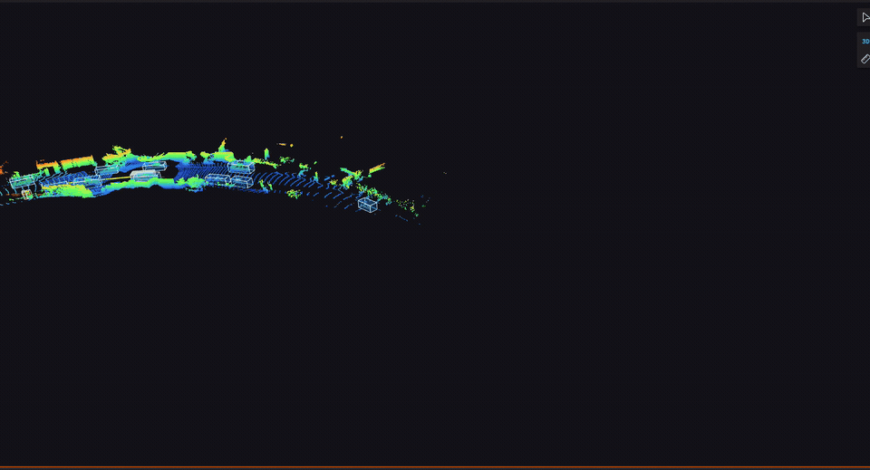
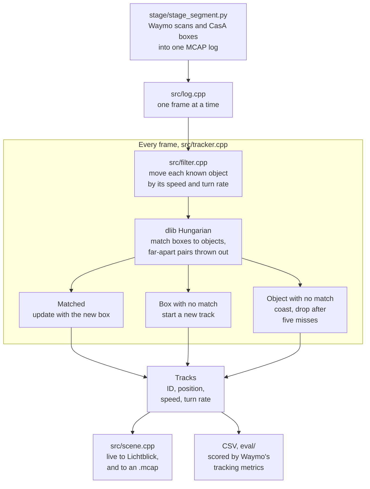

# Throughline

A live C++ tracker for road users in Waymo LiDAR data.

It takes a detector's boxes as each scan arrives and keeps one ID per object through missed
scans. Each track carries a speed, a turn rate and a three-second forecast, and the scene
streams to a viewer while it runs.



*Blue boxes are tracked cars. The line in front of each one is where the tracker thinks it is
going.*

## Results

The input boxes are CasA's published detections on Waymo's validation set, which is real
detector output with its misses and false alarms. Boxes scoring under 0.5 are dropped, and
pedestrian boxes under 0.7.

MOTA is the standard tracking score, where 1.0 means no mistakes. Waymo's own scoring code,
run by `make official` on 2026-10-18, gave these numbers at LEVEL_2 difficulty:

| scene                       | cars | people |
|-----------------------------|------|--------|
| fast road, 63 km/h          | 0.30 | 0.22   |
| crawling through a junction | 0.54 | 0.57   |
| slow turn, 21 km/h          | 0.72 | 0.34   |

Most lost points on the fast road are misses: the detector does not see distant cars that
the labels contain, and the tracker waits two scans before it reports a new object.

A frame takes 2 to 4 ms from read to published at the median and under 8 ms at the 99th
percentile, measured by `make live` on the fast-road clip on 2026-10-18. Scans arrive every
100 ms.

## Architecture



## Build and run

Needs `cmake`, `protobuf`, `zstd` and `lz4` from Homebrew, and Python with `pyarrow`,
`numpy`, `protobuf` and `mcap-protobuf-support`.

```
make test       # unit tests on a generated scene, no data needed
make check      # format and lint gates, zero findings
make stage      # one Waymo clip and its CasA boxes into a staged log
make live       # track at the scans' own pace, served on ws://127.0.0.1:8765
make run        # track flat out and write tracks.csv
make official   # score tracks.csv with Waymo's evaluator in Docker
```

To watch, open Lichtblick, choose Open connection, then Foxglove WebSocket, and enter
`ws://127.0.0.1:8765`.

Waymo's data cannot be shared, so re-running the clips needs a Waymo account. The CasA
detection files are linked from the
[3D-Multi-Object-Tracker](https://github.com/hailanyi/3D-Multi-Object-Tracker) repository
and carry the same licence.
